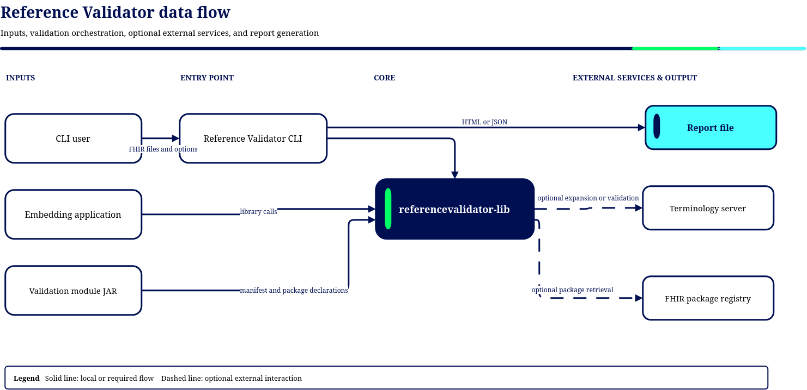

# 3. Context and Scope

## 3.1 Business context

The validator receives JSON or XML FHIR resources and returns validation findings. The CLI derives
an overall valid/invalid verdict and writes a report. Validation can use core FHIR definitions
without a module, additional packages supplied by a library caller, or a selected validation module.
Package downloads and remote terminology access are independent opt-in settings for validation.

Module publishers supply the application-specific interpretation of profiles, versions, periods,
and message policies. The Reference Validator supplies the processing engine and workflows.
Snapshot generation prepares distributable package content and does not validate an application's
business process or establish complete offline terminology coverage.

## 3.2 External interfaces

| Interface                                 | Direction | Description                                                                                                                                                                                                                       |
|-------------------------------------------|-----------|-----------------------------------------------------------------------------------------------------------------------------------------------------------------------------------------------------------------------------------|
| **CLI**                                   | in/out    | `validate`, `generate-snapshot`, and `configuration` commands; files, flags, YAML configuration, and HTML or JSON reports.                                                                                                        |
| **Java library API**                      | in/out    | Interfaces and model in `referencevalidator-lib`, including `ValidatorFactory`, `SnapshotGeneratorFactory`, and `ContextProvider`. Callers receive result objects or categorized failures.                                        |
| **Validation module JARs**                | in        | `ModuleLoader` reads metadata from `META-INF/config.yaml` using the API manifest model. Package Resolver separately imports embedded `package/*.tgz` archives. The loader does not invoke the module SPI through `ServiceLoader`. |
| **FHIR package registries / local cache** | in/out    | Packages are read from a local cache (default `~/.fhir/packages`) and remote packages may be resolved according to command configuration.                                                                                         |
| **Terminology server**                    | out       | Optional ValueSet expansion / terminology validation (e.g. ZTS `terminologien.bfarm.de`).                                                                                                                                         |
| **Reports**                               | out       | Console summary and HTML report by default, or a JSON report file.                                                                                                                                                                |

## 3.3 Technical context

| Concern           | Detail                                                                                                                                                                                                                       |
|-------------------|------------------------------------------------------------------------------------------------------------------------------------------------------------------------------------------------------------------------------|
| Input formats     | FHIR **JSON** and **XML**; the CLI selects the parser using `Files.probeContentType` for each file.                                                                                                                          |
| FHIR releases     | R4 (default) and R5. `FhirRelease` has no R6 implementation.                                                                                                                                                                 |
| Package format    | FHIR NPM packages (`.tgz`) or extracted package directories.                                                                                                                                                                 |
| Module descriptor | YAML at `META-INF/config.yaml` inside the module JAR; the manifest model declares spec version 3.0.                                                                                                                          |
| Concurrency       | The CLI uses Java **virtual threads** with a sliding in-flight window (default 5, maximum 32); each resource gets its own validator and context clone.                                                                       |
| Package reuse     | A batch-local template cache (capacity set to the in-flight limit) reuses package-set initialization; each lease returns an isolated context clone. Package resolution and generated snapshot archives have separate caches. |
| Input bounds      | Validation defaults to 1,000 files, 50 MiB/file, 500 MiB total, and depth 32; hard ceilings are 10,000 files, 100 MiB/file, 1 GiB total, and depth 64.                                                                       |

## 3.4 Module authoring context

The [module template](https://github.com/gematik/app-referencevalidator-module-template) is an
external starting project, not a runtime dependency or a module of this Maven reactor. It supplies
the layout for the manifest, SPI class and service registration, package inputs, build
configuration, and test resources. The published `validation-module-parent` connects that project
to the CLI for snapshot generation and verification.

Publishers distribute the generated module JAR separately from the validator. Operators choose
and test the validator/module combination before deployment. Consumers need the JAR, not its
source archives, patches, or build-time YAML files. See the
[module development guide](../user-guide/module-user-guide.md) for the complete authoring workflow.

