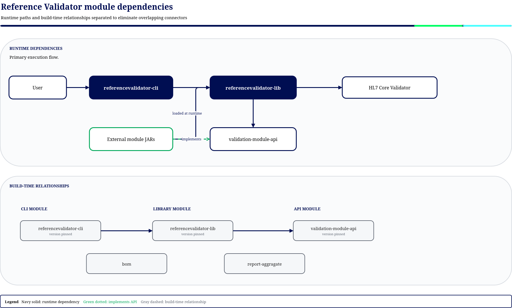

# 5. Building Block View

## 5.1 Level 1 — System decomposition

| Module                       | Responsibility                                                                                                           | Layer                              |
|------------------------------|--------------------------------------------------------------------------------------------------------------------------|------------------------------------|
| **referencevalidator-cli**   | Command-line boundary: parsing, YAML config, workflow coordination, HTML/JSON reporting.                                 | Boundary                           |
| **referencevalidator-lib**   | Public interfaces and model plus package resolution, validation, snapshot generation, context setup, and module loading. | BCE-style packages in one artifact |
| **validation-module-api**    | Plugin SPI and manifest model for external validation modules.                                                           | API/SPI                            |
| **validation-module-parent** | Managed build for external module projects, including snapshot generation and validation through the CLI.                | Build                              |
| **bom**                      | Dependency versions used by project modules and consumers.                                                               | Build                              |
| **report-aggregate**         | Aggregates JaCoCo reports.                                                                                               | Build                              |

There is no `core-lib`, `refv-lib`, or `cli` Maven module. The library's boundary, control, and
entity packages are organized inside `referencevalidator-lib`.

`performance-benchmarks` is an optional reactor module enabled by the `jmh` profile. The external
[validation module template](https://github.com/gematik/app-referencevalidator-module-template)
is not a reactor module. It is copied into a publisher-owned repository and consumes the build
support and API artifacts from this project.

## 5.2 Level 2 — referencevalidator-lib interfaces and model

**Key points**

* Many request, result, and configuration value types are records with defensive collection copies;
  not every domain-related type is a record.
* `FhirRelease` is a **sealed interface** permitting `R4Version` and `R5Version`, with Jackson
  serialization for YAML configuration.
* `FhirContext`, `ValidationContext`, `BatchValidationContextProvider` (including its lease),
  `Validator`, `SnapshotGenerator`, and resolver interfaces are boundaries implemented in the same
  library artifact.
* The **sealed exception hierarchy** (`RefValException`) carries a failure category (INITIALIZATION, CONFIGURATION,
  NETWORK, PARSING, INTERNAL, VALIDATION, SNAPSHOT,
  PACKAGE_LOADING). HL7 classes stay behind the checked library boundaries and are not used by the
  CLI.

## 5.3 Level 2 — referencevalidator-lib controls and adapters

**Responsibilities**

* `ContextProvider` / `DefaultContextProvider` — creates validation and snapshot contexts and opens
  a batch context provider through the boundary contract.
* `DefaultBatchValidationContextProvider` and `BatchValidationContextTemplateManager` — keep a bounded,
  batch-local, access-ordered cache of package-set templates. Leases protect templates while in use
  and create distinct validation-context clones; templates are never used for validation.
  `ValidationPackageSetKey` includes the full context configuration and ordered normalized package
  coordinates. This is a project-owned context-template cache, not a Caffeine cache.
* `DefaultValidationContext` and `DefaultSnapshotGenerationContext` — own HL7 engine interactions;
  validation converts `OperationOutcome` data to the engine-independent result model.
* `ValidationEngineFactory` — configures the HL7 engine from `ContextConfiguration`
  (display behavior, terminology server, validation policies, cache paths).
* `PackageResolver` / `DefaultPackageResolver` — resolves remote coordinates, local `.tgz` archives,
  directories, and package dependencies into the local package cache.
* `ValidationPackageSelector` + `ProfileValidityExtractor` — implement the package-selection
  algorithm (see §4.3).
* `ValidationModuleIndex` — builds the profile/version/period lookup at module load.
* `DefaultPackageProcessor` — resolves package dependencies, applies patches, generates snapshots,
  and writes `.tgz` archives. `SnapshotArchiveCache` reuses successful generated archives.

### Capability contracts and ownership

The `package-info.java` files define the following boundaries. Requirement identifiers are local
to each package. Implementation classes above support these contracts but do not enlarge their scope.

| Capability and contract                                                                                                       | Responsibility                                                                                                                                                                                        | Explicit boundary                                                                                                                                                                                        |
|-------------------------------------------------------------------------------------------------------------------------------|-------------------------------------------------------------------------------------------------------------------------------------------------------------------------------------------------------|----------------------------------------------------------------------------------------------------------------------------------------------------------------------------------------------------------|
| [Configuration Parser](../../referencevalidator-lib/src/main/java/de/gematik/refv/lib/config_parser/package-info.java), R2–R3 | Supplies one shared configured mapper per format, ISO calendar dates, readable serialization, strict unknown-property handling, and actionable YAML diagnostics.                                      | Does not select or read sources, define defaults or precedence, validate domain configuration, or translate consumer exceptions.                                                                         |
| [FHIR Context](../../referencevalidator-lib/src/main/java/de/gematik/refv/lib/fhir_context/package-info.java), R1–R6          | Creates and clones configured R4/R5 contexts, delegates validation and snapshot work to the engine, manages temporary terminology-cache ownership, and supplies batch templates through leases.       | Does not own package resolution, the validation workflow, or the snapshot workflow. Concrete HL7 types stay out of its operation signatures.                                                             |
| [Package Resolver](../../referencevalidator-lib/src/main/java/de/gematik/refv/lib/package_resolver/package-info.java), R1–R7  | Resolves coordinates, local directories and archives, imports embedded core and module packages, and reports package identity, path, and dependencies.                                                | Does not choose module packages by profile/date or perform validation or snapshot generation. Transitive requests are dependency-first. List resolution retains input order.                             |
| [Snapshot](../../referencevalidator-lib/src/main/java/de/gematik/refv/lib/snapshot/package-info.java), R1–R3                  | Resolves the complete dependency graph before generation, rejects missing dependencies and cycles, generates each package at most once per request, applies patches, and archives successful results. | Does not load modules or implement its own resolver. A failed package blocks its dependents, not unrelated packages. Returned results are immutable and the generator releases owned resources on close. |
| [Validation](../../referencevalidator-lib/src/main/java/de/gematik/refv/lib/validation/package-info.java), R1–R7              | Creates validators, extracts module profile/date information, selects packages, and applies suppression, severity, ignored-terminology, and result-filter policies.                                   | Does not construct engines, load modules, download packages, generate snapshots, or schedule CLI batches. Caller-owned contexts remain caller-owned.                                                     |
| [Validation Module](../../referencevalidator-lib/src/main/java/de/gematik/refv/lib/valmodule/package-info.java), R1–R4        | Searches named JAR modules, loads snapshot-module metadata from a root directory, imports manifests, and supplies a default loader. First matching name wins.                                         | Does not import FHIR packages or instantiate SPI providers. No valid match in a valid directory returns an empty result. Invalid directories and invalid snapshot manifests produce loading failures.    |

`exceptions` provides shared categorized failures and has no package-level contract file in the
reviewed library. Known contract/implementation differences are listed in
[chapter 11](11-risks-and-technical-debt.md).

## 5.4 Level 2 — validation-module-api (SPI)

The `META-INF/config.yaml` manifest (spec version 3.0) declares package groups, profile families,
message-transformation templates, global suppression rules, ignored code systems, and ignored
ValueSets. Constructors validate package-group and transformation references.

A module built from the template also contains a small `FhirValidationModule` implementation and
its `META-INF/services` registration. The current loader reads the manifest through a JAR class
loader. It neither discovers providers through `ServiceLoader` nor calls custom validation logic.
Module name, module release version, manifest format version, and FHIR package versions are distinct
identities. The loader selects by manifest name, not Maven artifact ID or newest release version.

## 5.5 Level 2 — referencevalidator-cli (Boundary)

The boundary translates CLI arguments and YAML into library configuration, coordinates validation
and snapshot operations, and writes HTML or JSON reports. Validation input collection and virtual
thread execution are bounded by configurable limits; the batch context cache capacity is tied to the
configured in-flight validation count. ArchUnit tests prohibit CLI dependencies on HL7 types; library
rules cover selected boundary packages.

## 5.6 Module build support

`validation-module-parent` manages an exec plugin that runs the CLI at `generate-resources` and
`verify`. The child module project must declare that plugin to activate its managed executions.
Only `META-INF/**` resources and generated `package/**/*.tgz` archives are included by the parent
resource configuration. Source packages and patches are build inputs, not separately shipped
resources. Detailed phase ordering and release responsibilities are described in
[chapter 7](07-deployment-view.md).

