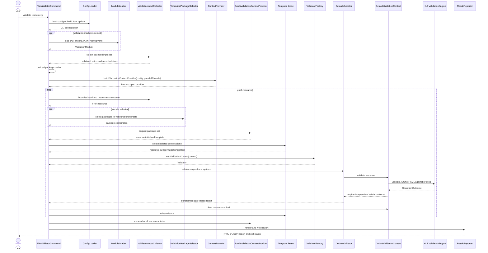
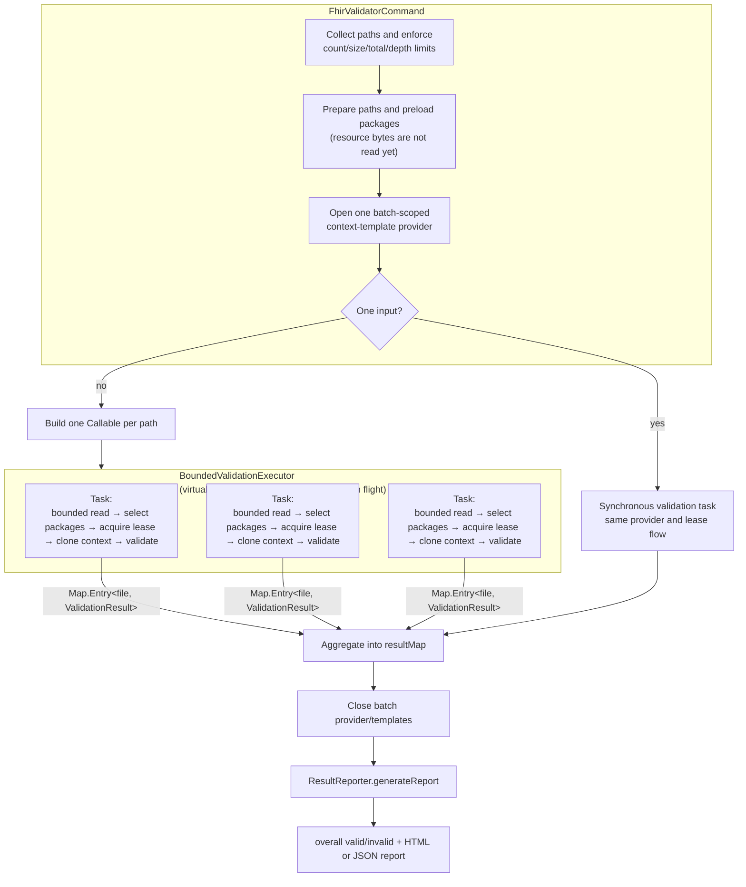
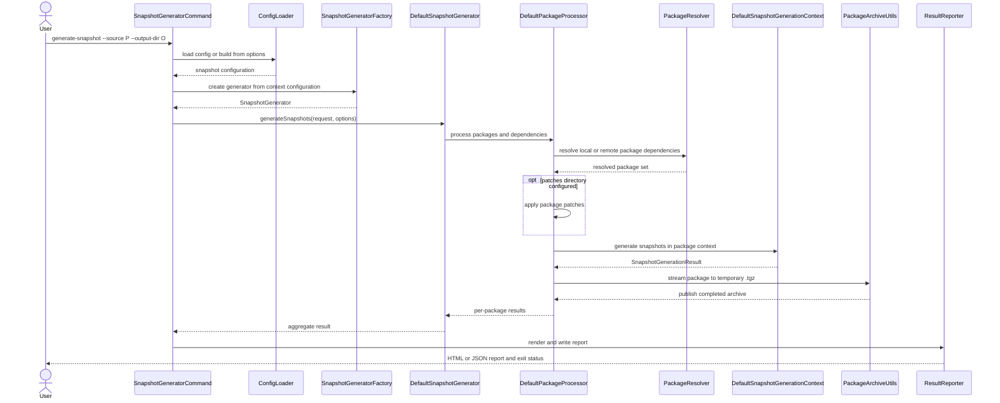
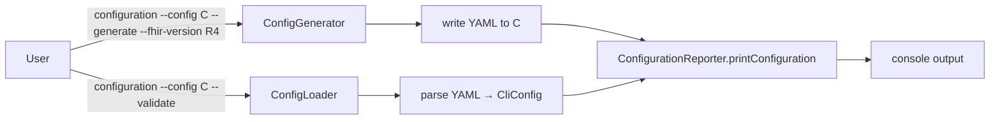

# 6. Runtime View

This section shows the dynamic behavior for the two main operations: **Validation** and **Snapshot Generation**.

## 6.1 Validation — single resource

**Notes**

* The module index is built after loading the manifest and resolves profile/version/date lookups.
* One batch-scoped provider is shared by the single-input and multi-input paths. It owns a capped,
  access-ordered package-set template cache; active leases protect templates from eviction. A
  template is only a clone source and is never used to validate a resource.
* Every resource owns a distinct context clone and validator, closes the context, then releases its
  lease. Closing the batch provider occurs after single validation completes or after all concurrent
  tasks finish.
* `DefaultValidationContext` converts the HL7 `OperationOutcome` into `ValidationResult`.
* The validator applies suppression, severity transformations, ignored-terminology handling, and
  severity filtering before the CLI derives the verdict. An informational no-error message is
  returned when suppression or filtering removes all findings.
* For direct library use, `ValidatorFactory.withCoreDefinitions(...)` and
  `withCustomPackages(...)` create owned contexts. Closing the validator closes those contexts.
  `withValidationContext(...)` uses the caller's context without cloning or taking ownership.
  A library caller must explicitly compose module loading, archive import, package selection,
  and the applicable validation options. See the [library guide](../user-guide/library-user-guide.md).

## 6.2 Validation — concurrent batch (virtual threads)

**Thread-safety and bounds:** the CLI retains one `Callable` per collected path but submits only a
sliding window of at most `--parallel-threads` tasks (default 5, valid range 1–32) to a virtual-thread
executor. Each task uses its own context clone and `ValidatorFactory.withValidationContext(...)`;
package-set template initialization is reused only within that invocation and while retained by the
capped cache. Per-resource failures are converted to that resource's validation result, and report
generation follows completion of the batch.

Input collection defaults to 1,000 files, 50 MiB per file, 500 MiB combined, and directory depth 32.
Hard ceilings are 10,000 files, 100 MiB per file, 1 GiB combined, and depth 64. Resource contents are
read with the per-file bound inside each task rather than eagerly retained for the whole batch.

## 6.3 Snapshot Generation

**Key runtime properties**

* **Dependency preflight:** resolve the full transitive graph for selected roots before generating
  any snapshots. A cycle or unavailable dependency returns an error without starting generation.
  The processor generates dependencies before dependents and provides their archived snapshots to
  downstream packages. Each package coordinate is generated and archived at most once per request.
* **Package-group isolation:** in module mode, package groups remain distinct and the CLI creates a
  fresh `SnapshotGenerator` for each selected manifest package group.
* **Streaming and archive safety:** `PackageArchiveUtils` streams entry bytes, sorts entry paths,
  normalizes TAR metadata, rejects traversal and link entries, and enforces extraction limits.
  Archives are written to a temporary file and published only after compression succeeds.
* **Generated-archive reuse:** `SnapshotArchiveCache` can reuse a previously generated archive based
  on package content, dependency archives, and cache namespace. This is a file-backed cache, not a
  Caffeine cache.
* **Failure handling:** failed extraction removes partial output. Failed compression does not
  publish a partial final archive. A generation failure blocks dependent packages while unrelated
  packages continue and successful archives remain available. Any ERROR or FATAL outcome makes the
  aggregate result unsuccessful. A completed call alone does not demonstrate successful generation.
* **Context work:** the FHIR Context generates missing snapshots for StructureDefinitions with a
  base definition and writes them back into the working package directory. A package without
  StructureDefinitions produces a warning that generation was skipped. The Snapshot capability
  owns working-copy preparation and archiving, not the engine context.
* **Cleanup:** close the generator after processing. Closure releases its owned contexts and is
  idempotent. Persistent package and generated-archive caches are not removed by closing it.

## 6.4 Configuration command

The `configuration` command generates a validation or snapshot configuration, or validates and
prints an existing one. Validation defaults to no remote package downloads (`--online-mode` opts in);
snapshot generation permits remote package downloads unless `--offline-mode` is set. Terminology
server use is configured separately.

The validation and snapshot CLI configurations have different top-level types. A module manifest
is a third, separate format. When `--config` is supplied, its configuration is used rather than
merged with corresponding context and module flags. Resource inputs and snapshot source/output
remain command arguments. Paths are relative to the process working directory, not the YAML file.
Unknown keys are rejected. Consumers must retain the parsing reason and available field or source
location when reporting failures. `--json`, not the YAML report format alone, selects JSON output.

## 6.5 Building a validation module

The template-derived module project executes the validator as a build tool. It is not rebuilding
or releasing the Reference Validator itself.

1. The publisher defines `META-INF/config.yaml`, package sources or coordinates, optional patches,
   and positive FHIR test instances. Snapshot and validation CLI settings reside in separate files.
2. During `generate-resources`, the parent's `build-snapshot` execution reads
   `snapshot.config.yaml`, resolves the declared groups, applies patches, and writes archives to
   `target/generated-resources/package/`. Registry and terminology access can be enabled here.
3. Maven packages the manifest, provider class and registration, and generated archives into the
   module JAR. Source archives under `src-package/` are not copied as separate source resources.
4. During `verify`, `validate-module` reads `validator.config.yaml`, loads the just-built JAR from
   `target/`, and validates `src/test/resources/fhir/` recursively. The recommended configuration
   disables both package downloads and remote terminology access to verify offline deployment.
5. The publisher reviews snapshot and validation reports. A non-zero CLI status fails the managed
   Maven execution through `blockSystemExit=true`. Expected-invalid examples require dedicated
   assertion tests rather than inclusion in this positive-test directory.

`mvn package` stops before verification. `mvn clean verify` runs both managed executions when the
child has activated the exec plugin. `mvn clean install` also verifies before local installation.
See the [module guide](../user-guide/module-user-guide.md) for project files and configuration.

