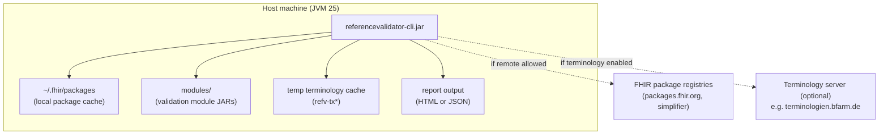

# 7. Deployment View

## 7.1 Delivery forms

The Referenzvalidator is delivered as a CLI and as Maven library artifacts (see
[`cli-user-guide.md`](../user-guide/cli-user-guide.md)):

| Form                     | Artifact                                                     | Use                                                                                                                    |
|--------------------------|--------------------------------------------------------------|------------------------------------------------------------------------------------------------------------------------|
| **CLI application**      | `referencevalidator-cli-<version>-jar-with-dependencies.jar` | Stand-alone command-line tool.                                                                                         |
| **Java library**         | `referencevalidator-lib` and `validation-module-api`         | Embedded into other applications; dependency versions are managed by the project BOM.                                  |
| **Module build support** | `validation-module-parent` and `bom`                         | Used by separate module projects to select compatible API and CLI tooling. Not a deployed validation module.           |
| **Validation module**    | Publisher-owned module JAR                                   | Separate application-specific manifest and generated FHIR packages. Obtained independently from the validator release. |

## 7.2 CLI deployment

* **Modules directory** — `validate` scans the directory supplied through `--modules-folder` for
  JARs directly inside it and loads the first manifest name matching `--module-name`, ignoring case.
  The JAR contains `META-INF/config.yaml` and generated `package/*.tgz` archives. There is no
  highest-version selection. Keep only the intended release for each module name in that directory.
* **Package cache** — validation defaults to `~/.fhir/packages` and does not download remote packages
  unless `--online-mode` is enabled. Snapshot generation defaults to the persistent
  `~/.fhir/snapshot-packages` cache and permits downloads unless `--offline-mode` is set. Both paths
  can be configured. Operators own their retention and cleanup.
* **Terminology access** — configured separately from package downloads. When enabled, the engine
  uses a terminology cache. Library-created temporary caches are removed after the last sharing
  context closes. An explicitly configured terminology cache is caller-owned and preserved.
* **Reports** — HTML by default or JSON with `--json`. Operators must protect the chosen output path
  because reports may contain resource details.
* **Validation workload limits** — defaults are 1,000 input files, 50 MiB per file, 500 MiB total,
  directory depth 32, and 5 in-flight validations. Configurable values cannot exceed hard ceilings
  of 10,000 files, 100 MiB per file, 1 GiB total, depth 64, and 32 concurrent validations.
* **Batch context templates** — retained only for one `validate` invocation; the cache capacity is
  at most the configured in-flight validation count. Each resource context is closed by the caller,
  and the provider closes retained templates after active leases have been released.

## 7.3 Library embedding

When embedded, the host application should use the dependency versions managed by the project BOM,
provide suitable filesystem permissions for package and temporary caches, and close contexts,
batch-context providers, and leases where the API exposes `AutoCloseable`. The library resolves core
and module packages through its package resolver; confirm release-specific transitive dependencies
before deployment.

Importing module archives into the configured package cache and selecting packages are explicit
steps in the [library workflow](../user-guide/library-user-guide.md). Loading a manifest alone
does not install packages in a validator. Validators created from configuration own their contexts.
A validator wrapping an existing context leaves that context open when closed.

## 7.4 Infrastructure requirements

| Aspect  | Requirement                                                                                                                               |
|---------|-------------------------------------------------------------------------------------------------------------------------------------------|
| Runtime | Java 25 JVM                                                                                                                               |
| Memory  | Size for the selected FHIR packages and input workload; no verified minimum heap is specified in the repository.                          |
| Network | Needed only when remote package downloads or terminology access are enabled. Offline operation requires packages to be available locally. |
| Disk    | Package cache, temporary snapshot/terminology data, and report output.                                                                    |

## 7.5 Product and module release lifecycles

The validator and its validation modules are separate release units. Independence allows a module
publisher to add profiles or adjust validity periods without rebuilding the engine. It does not
remove the need to verify compatibility with the chosen validator release.

| Aspect           | Reference Validator                                                                                    | Validation module                                                                                                                                                                                           |
|------------------|--------------------------------------------------------------------------------------------------------|-------------------------------------------------------------------------------------------------------------------------------------------------------------------------------------------------------------|
| Ownership        | Validator maintainers own the CLI, library capabilities, engine adapters, API, BOM, and module parent. | The module publisher owns the manifest, profile/package mappings, patches, message policies, examples, and limitations.                                                                                     |
| Starting project | This Maven reactor.                                                                                    | A separate repository created from the [module template](https://github.com/gematik/app-referencevalidator-module-template). Template updates do not automatically update projects already created from it. |
| Build            | Compiles and tests the engine integration, workflows, CLI, API, and supporting artifacts.              | Consumes a compatible parent and CLI. Generates snapshots at `generate-resources`, builds a JAR, then verifies that JAR at `verify`.                                                                        |
| Release trigger  | Changes to engine behavior, library or CLI contracts, infrastructure, or supported tooling.            | Changes to implementation-guide content, dependencies, date rules, patches, or interpretation policies.                                                                                                     |
| Version identity | Product/artifact release, currently `3.0.0-SNAPSHOT` in this checkout.                                 | Publisher-defined module release version. Neither the FHIR profile/package version nor manifest `configSpecVersion` is the module release version.                                                          |
| Distribution     | CLI release and Maven artifacts.                                                                       | Separately published JAR plus supported profiles, compatibility information, release notes, and limitations.                                                                                                |
| Adoption         | The host application or operator upgrades the library/CLI after regression testing.                    | The operator deploys the selected JAR into the modules directory and selects its manifest name. No runtime auto-update or hot-reload contract is provided.                                                  |

The [original concept](../concept/concept.md) specifies SemVer for the product and MAJOR.MINOR
for modules, with behavioral changes to older instances requiring a module major-version change.
The current manifest accepts the publisher's version string rather than enforcing that convention.
The loader does not negotiate an engine compatibility range or choose the newest module release.

### Compatibility and release checks

* Select a concrete `validation-module-parent` release and matching validator tooling. Keep the
  API and dependency versions aligned through the BOM. A module may have its own version even when
  the parent and CLI versions are identical to each other.
* Replace template placeholders and keep provider `getName()`, manifest `name`, and runtime module
  selection consistent. Include the provider and service registration even though the current
  loader is manifest-driven.
* Pin package versions for a released module. Review snapshot reports, then run positive examples
  against the built JAR with downloads and terminology access disabled. Add assertion tests for
  invalid instances, period boundaries, and message policies.
* When upgrading either release unit, replay representative older and current instances, including
  the [3.0.0 migration cases](../Regressions.md). Engine changes can require module patches or rule
  revisions even when the manifest format remains unchanged.
* Publish the tested validator/module combination and any terminology exclusions. Retain the exact
  artifacts, configuration, and package provenance needed to reproduce a referee decision or roll
  back a deployment. Rebuilding from mutable registries is not a substitute for retaining artifacts.

## 7.6 Runtime ownership lifecycle

An installed module JAR is input content. It does not run a service or own a validation engine.
Module loading returns parsed metadata and the JAR path. Package import populates the resolver's
cache. A validation invocation owns its module index, batch provider, leases, and resource contexts.

For each resource, close its context before releasing its package-set lease. Closing the batch
provider releases templates after active leases end. Temporary terminology-cache ownership may be
shared across clones and ends only when the last owning context closes. Explicit caches, module
JARs, generated snapshot archives, and reports remain under operator control. A snapshot generator
has its own closeable lifecycle and does not extend the lifetime of a deployed module.

