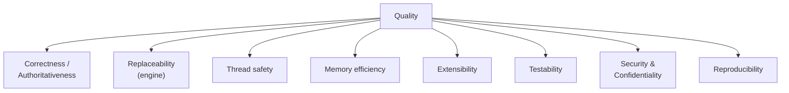

# 10. Quality Requirements

## 10.1 Quality tree

## 10.2 Quality scenarios

| ID   | Quality                   | Scenario                                                                              | Response / Measure                                                                                                                                                                                                                     |
|------|---------------------------|---------------------------------------------------------------------------------------|----------------------------------------------------------------------------------------------------------------------------------------------------------------------------------------------------------------------------------------|
| QS1  | Correctness               | A resource is validated against a TI profile                                          | The HL7 engine produces the conformance findings; module transformations and suppression rules are applied before the project result is reported. Exact equivalence with a separate HL7 CLI is not established by this repository.     |
| QS2  | Correctness               | A resource date falls outside all configured periods                                  | With period checking enabled, package selection raises `ProfileOutsideValidityPeriodException`.                                                                                                                                        |
| QS3  | Separation                | CLI code is changed to depend directly on an HL7 type                                 | The CLI ArchUnit test fails. Library ArchUnit tests protect named boundary packages, not every public type in every module.                                                                                                            |
| QS4  | Thread safety             | Multiple files with the same package set are validated concurrently                   | At most `--parallel-threads` validations are in flight (default 5, maximum 32); each uses a distinct context clone and validator from a batch template. Parity and isolation must hold against the legacy factory path.                |
| QS5  | Memory and integrity      | A package is repackaged                                                               | Entry data is streamed; entries are path-sorted, metadata is normalized, and a completed temporary archive is published only after compression. No peak-memory target is specified.                                                    |
| QS6  | Extensibility             | A new application needs its own profiles and package groups                           | Load an external module JAR with a `META-INF/config.yaml` manifest conforming to API spec 3.0.                                                                                                                                         |
| QS7  | Archive security          | An archive contains traversal paths, links, too many entries, or oversized content    | Extraction rejects the entry/archive and removes partial extraction output.                                                                                                                                                            |
| QS8  | Reliability               | A package registry is unavailable                                                     | With remote package downloads disabled, only local packages are resolved; missing packages lead to a package-resolution failure. Terminology access is a separate setting.                                                             |
| QS9  | Input safety              | An input count, file, aggregate size, or directory depth exceeds its configured bound | Collection fails before validation; symlinks and non-regular files are rejected. Defaults are 1,000 files / 50 MiB each / 500 MiB total / depth 32; hard ceilings are 10,000 / 100 MiB / 1 GiB / depth 64.                             |
| QS10 | Bounded reuse             | A batch contains many distinct package sets                                           | The template cache retains no more than its configured capacity (currently set to the in-flight validation count); active leases are not evicted, and the provider closes retained templates at batch end.                             |
| QS11 | Module portability        | A publisher builds a module from the template with compatible tooling                 | `mvn clean verify` generates snapshots, packages the JAR, then validates positive instances with remote package and terminology access disabled in the test configuration. `mvn package` alone is insufficient.                        |
| QS12 | Migration compatibility   | A validator or module release changes                                                 | Replay representative valid and invalid instances, period boundaries, and the five regression categories in `Regressions.md`. Review severity changes and child-validation coverage before adoption.                                   |
| QS13 | Snapshot reliability      | A dependency graph contains a cycle or an unavailable package                         | Return an error result before generating any snapshots. With an acyclic graph, process dependency-first and generate each coordinate at most once per request.                                                                         |
| QS14 | Partial-failure isolation | Generation fails for one package after preflight succeeds                             | Skip its dependents, continue unrelated packages, retain successful archives, and report overall failure when any ERROR or FATAL occurs.                                                                                               |
| QS15 | Resource ownership        | Validators and contexts close in an embedded application                              | Configuration-created validators close their owned contexts. Context-wrapping validators leave the caller's context open. Delete temporary terminology caches only after their last owning context closes, preserving explicit caches. |
| QS16 | Configuration diagnostics | YAML has an unknown field, incompatible value, or syntax error                        | Reject it and preserve the field/reason and available source location through consumer exception translation. Shared mappers remain unchanged.                                                                                         |
| QS17 | Result-policy correctness | A message matches suppression, transformation, and ignored terminology rules          | Process suppression before first-match transformation, then ignored-terminology downgrading and severity filtering. Return an informational no-error result if no messages remain.                                                     |
| QS18 | Selection correctness | A module resource has no usable date, a blank date locator, or multiple profiles | Absent and unusable dates use the module's undated fallback. Failed evaluation, multiple date results, non-date results, and partial dates do not fail extraction. Blank locators and multiple top-level profiles remain errors. Verify JSON/XML and R4/R5 behavior separately from direct validation. |
| QS19 | Module loading | A named module is absent or candidate JARs are invalid | Return an empty result if a valid directory contains no valid match. Skip invalid candidates with diagnostics, require both metadata files in the candidate JAR itself, and select the first valid match without importing packages or executing providers. |

## 10.3 Metrics & gates

* **Coverage:** JaCoCo per module + aggregated report (`report-aggregate`); Sonar configuration is present.
* **Architecture:** ArchUnit rules check selected CLI and library boundaries; they do not enforce a
  whole-project BCE layer model or a separate `core-lib` API.
* **Format/style:** Spotless (google-java-format), license-header check.
* **Build:** Maven Enforcer (dependency convergence, Java/Maven versions).
* **Capability contracts:** boundary requirement tests cover configuration mappers, FHIR Context,
  package resolution, module loading, profile selection, validator behavior, result policies, and snapshot lifecycle.
  Test presence is evidence of intended coverage, not a passing verdict for this checkout.
* **Module releases:** inspect the shipped manifest and archives, review both build reports, and
  use dedicated library assertion tests for expected-invalid instances. The parent's verification
  directory is for positive examples.

The repository sets input-policy defaults and hard ceilings and bounds concurrent work, but these
values are not verified workload, throughput, or heap-capacity guarantees. Define those targets with
representative FHIR packages and hardware before treating performance or memory use as a quality
gate. Concurrent clone-parity and real implementation-guide tests are present. Their successful
execution must be established by release verification. This documentation review does not claim a
fresh passing test run or resolve the contract differences listed in chapter 11.

