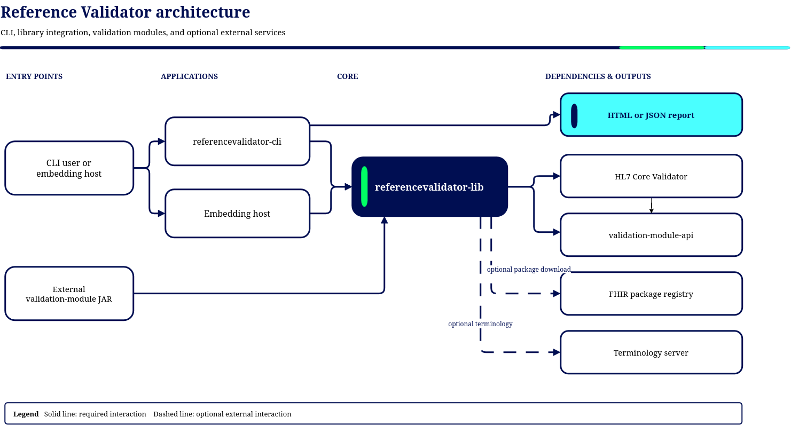

# gematik Referenzvalidator — Architecture Documentation (arc42)

**Version:** 3.0.0-SNAPSHOT · **Reviewed:** 2026-10-16 · **Template:** [arc42](https://arc42.org)

This document describes the architecture of the gematik Referenzvalidator, a library and CLI for
validating FHIR resources and generating FHIR snapshots for the German Telematikinfrastruktur (TI).

## Table of Contents

1. [Introduction and Goals](01-introduction-and-goals.md)
2. [Architecture Constraints](02-architecture-constraints.md)
3. [Context and Scope](03-context-and-scope.md)
4. [Solution Strategy](04-solution-strategy.md)
5. [Building Block View](05-building-block-view.md)
6. [Runtime View](06-runtime-view.md)
7. [Deployment View](07-deployment-view.md)
8. [Cross-cutting Concepts](08-cross-cutting-concepts.md)
9. [Architecture Decisions](09-architecture-decisions.md)
10. [Quality Requirements](10-quality-requirements.md)
11. [Risks and Technical Debt](11-risks-and-technical-debt.md)
12. [Glossary](12-glossary.md)

---

## Overview diagram

The default Maven reactor contains six modules: `bom`, `validation-module-parent`,
`validation-module-api`, `referencevalidator-lib`, `referencevalidator-cli`, and `report-aggregate`.
The `jmh` profile adds `performance-benchmarks`. The CLI coordinates bounded validation batches.
Each resource receives its own validator and context clone from a batch-scoped package-set template.
The library groups interfaces, domain types, and implementations in Boundary-Control-Entity (BCE)
packages within one artifact.

Validation modules are separate deliverables, not reactor modules of this repository.
`validation-module-api` supplies their manifest model and SPI. `validation-module-parent` supplies
their managed build, while the external
[module template project](https://github.com/gematik/app-referencevalidator-module-template)
provides a starting repository. [Chapter 7](07-deployment-view.md) explains their independent
release lifecycle and the runtime ownership rules.

## Documentation basis

This review uses the [CLI guide](../user-guide/cli-user-guide.md),
[library guide](../user-guide/library-user-guide.md),
[module development guide](../user-guide/module-user-guide.md), and
[2.17.0 to 3.0.0 regression notes](../Regressions.md). The six library package contracts are linked
in [chapter 5](05-building-block-view.md). They define capability responsibilities and required
behavior. Confirmed differences between those contracts and the implementation are recorded in
[chapter 11](11-risks-and-technical-debt.md), rather than presented as implemented guarantees.

The [concept](../concept/concept.md), updated for the same 3.0.0-SNAPSHOT documentation baseline,
provides German-language business and governance background and a technical overview. It preserves
requirement identifiers and explicitly separates historical E-Rezept/HAPI rules from current behavior
and known limitations. The detailed technical design remains in these architecture chapters.
Exported overview images are supplementary. The module inventory and contracts in this documentation
describe the reviewed checkout.

